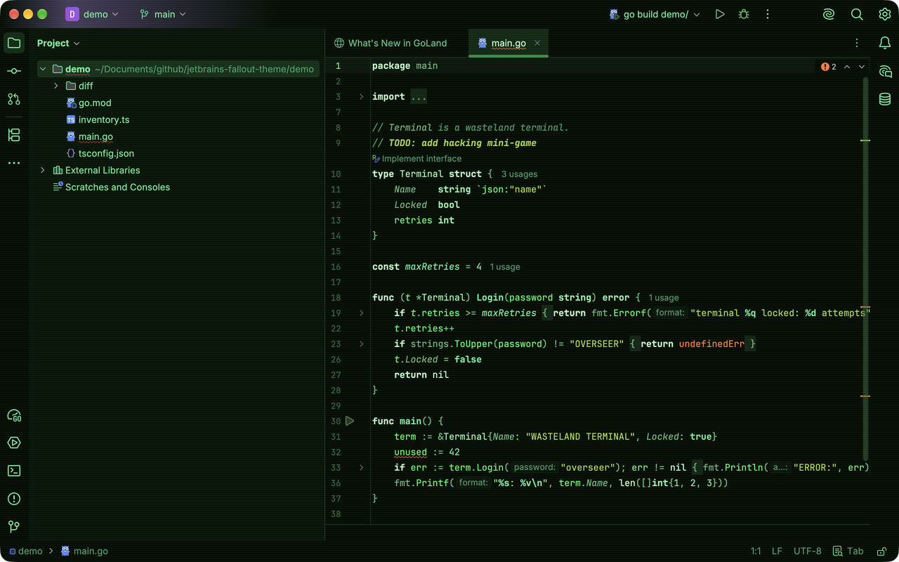

# Wasteland Terminal — theme for JetBrains IDEs

[](https://plugins.jetbrains.com/plugin/35747-wasteland-terminal)
[](https://plugins.jetbrains.com/plugin/35747-wasteland-terminal)

A dark green-phosphor theme inspired by retro CRT terminals, for GoLand, PhpStorm,
IntelliJ IDEA, WebStorm, PyCharm and other JetBrains IDEs. A matching terminal theme for
Ghostty / cmux lives in [ghostty-fallout-theme](https://github.com/chlp/ghostty-fallout-theme).


"Wasteland Terminal CRT" variant with scanlines:



## What's included

- **UI theme** — tool windows, popups, tabs, buttons, selection and scrollbars in phosphor
  greens. Built on top of the New UI dark theme; uses the Islands look on 2025.3+.
- **Editor color scheme "Wasteland Terminal"** — syntax colors for Go, PHP, JS/TS,
  HTML/XML/CSS, Markdown, YAML, JSON, SQL and shell, plus diffs, debugger, search highlights
  and console / terminal ANSI colors.
- **"Wasteland Terminal CRT" variant** — the same theme with subtle CRT scanlines across the
  editor and tool windows (a tiled background image, painted under the text). The IDE switches
  to the classic flat layout instead of Islands while a background image is set, which is why
  this is a separate theme. Tune or turn the lines off in
  **Settings -> Appearance & Behavior -> Appearance -> Background Image**.
- Errors are amber-orange and warnings amber-yellow — the only non-green colors, so problems
  stay visible.

| Path | What it is |
|---|---|
| `src/themes/WastelandTerminal.theme.json` | UI theme (generated) |
| `src/themes/WastelandTerminalCRT.theme.json` | UI theme with scanlines (generated) |
| `src/themes/crt-scanlines.png` | Scanline tile for the CRT variant (generated) |
| `src/themes/WastelandTerminal.xml` | Editor color scheme (generated) |
| `src/META-INF/plugin.xml` | Plugin descriptor |
| `src/META-INF/pluginIcon.svg` | Plugin icon |
| `generate.py` | Palette + generator for both theme files |
| `build.sh` | Packs the plugin jar into `dist/` |
| `demo/` | Sample files used for the screenshots |

## Install

From [JetBrains Marketplace](https://plugins.jetbrains.com/plugin/35747-wasteland-terminal): **Settings -> Plugins -> Marketplace** -> search for
**Wasteland Terminal** -> **Install**.

From source:

```bash
git clone https://github.com/chlp/jetbrains-fallout-theme.git
cd jetbrains-fallout-theme
./build.sh    # -> dist/wasteland-terminal-<version>.jar and dist/WastelandTerminal.icls
```

Then in the IDE:

1. **Settings -> Plugins -> ⚙ -> Install Plugin from Disk…** -> pick the jar from `dist/`.
2. **Settings -> Appearance & Behavior -> Appearance -> Theme -> Wasteland Terminal** (or
   **Wasteland Terminal CRT**). The editor scheme switches automatically.

If **Sync with OS** is enabled in Appearance, set Wasteland Terminal as the preferred dark
theme there, otherwise the IDE switches back to its default dark theme.

### Editor colors only

To keep your UI theme and use only the editor colors, pick
**Settings -> Editor -> Color Scheme -> Wasteland Terminal** (with the plugin installed), or
import `dist/WastelandTerminal.icls` via **⚙ -> Import Scheme…** without installing it.

## Customizing

The palette lives at the top of `generate.py`; scanline period and strength are
`SCANLINE_PERIOD` and `SCANLINES_BG["transparency"]`. After editing run:

```bash
./build.sh --generate
```

This regenerates `src/themes/*` and rebuilds the jar. Reinstall the jar and restart the IDE.

## Releasing a new version

1. Bump `<version>` and update `<change-notes>` in `src/META-INF/plugin.xml`.
2. Run `./build.sh`.
3. Upload the jar on the plugin's Marketplace page (**Upload Update**).

## Notes

- There is no real CRT shader (curvature, glow, flicker) — JetBrains IDEs have no custom
  shader support; the CRT variant only adds static scanlines. For the full CRT look in the
  terminal use
  [ghostty-fallout-theme](https://github.com/chlp/ghostty-fallout-theme).
- Requires IntelliJ Platform 2023.3 or newer.

## Uninstall

**Settings -> Plugins -> Installed -> Wasteland Terminal -> Uninstall**, then restart the IDE.

## License

[MIT](LICENSE)
