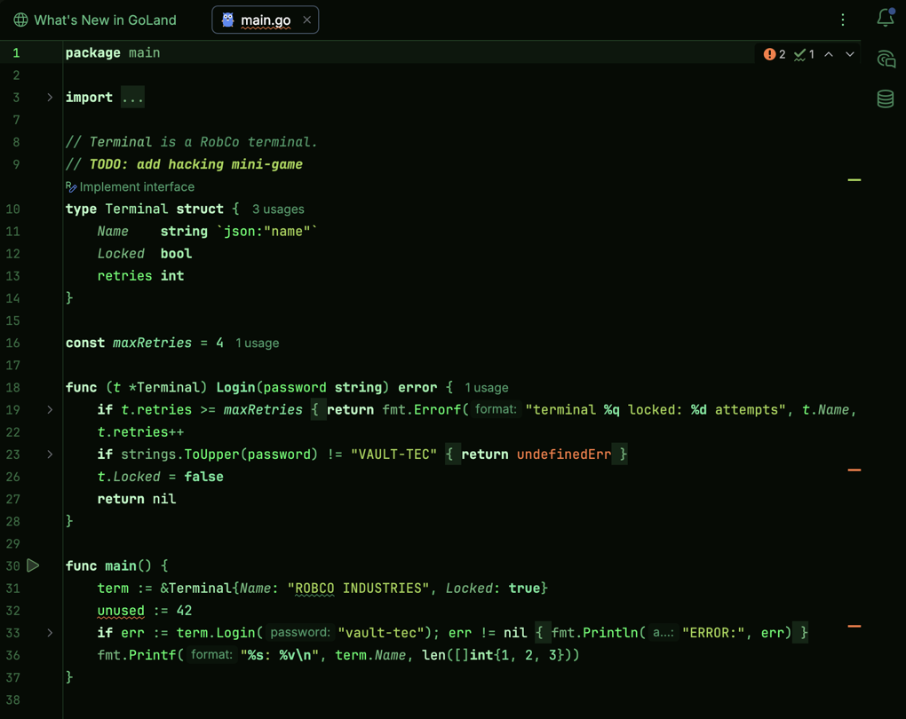

# Fallout theme for JetBrains IDEs

Green phosphor dark theme inspired by Pip-Boy terminals for GoLand, PhpStorm, IntelliJ IDEA,
WebStorm, PyCharm and other JetBrains IDEs. Companion of
[ghostty-fallout-theme](https://github.com/chlp/ghostty-fallout-theme) (Ghostty / cmux).



## What's included

- **UI theme** — tool windows, popups, tabs, buttons, selection and scrollbars in phosphor
  greens. Built on top of the New UI dark theme; uses the Islands look on 2025.3+.
- **Editor colour scheme "Fallout"** — syntax colours for Go, PHP, JS/TS, HTML/XML, Markdown,
  YAML, SQL and shell, plus diffs, debugger, search highlights and console / terminal ANSI
  colours (0–7 match the Ghostty palette).
- Errors are amber-orange and warnings amber-yellow — the only non-green colours, so problems
  stay visible.

| File | What it is |
|---|---|
| `src/themes/Fallout.theme.json` | UI theme (generated) |
| `src/themes/Fallout.xml` | Editor colour scheme (generated) |
| `src/META-INF/plugin.xml` | Plugin descriptor |
| `generate.py` | Palette + generator for both theme files |
| `build.sh` | Packs the plugin jar into `dist/` |

## Install

```bash
git clone https://github.com/chlp/jetbrains-fallout-theme.git
cd jetbrains-fallout-theme
./build.sh    # -> dist/fallout-theme.jar and dist/Fallout.icls
```

In the IDE:

1. **Settings -> Plugins -> ⚙ -> Install Plugin from Disk…** -> pick `dist/fallout-theme.jar`.
2. **Settings -> Appearance & Behavior -> Appearance -> Theme -> Fallout**. The editor scheme
   switches automatically.

If **Sync with OS** is enabled in Appearance, set Fallout as the preferred dark theme there,
otherwise the IDE switches back to its default dark theme.

### Editor colours only

To keep your UI theme and use only the editor colours, import `dist/Fallout.icls` via
**Settings -> Editor -> Color Scheme -> ⚙ -> Import Scheme…**.

## Customising

The palette lives at the top of `generate.py`. After editing it run:

```bash
./build.sh --generate
```

This regenerates `src/themes/*` and rebuilds the jar. Reinstall the jar and restart the IDE.

## Notes

- There is no CRT shader here — JetBrains IDEs have no custom shader support. For the full CRT
  look use the terminal theme from
  [ghostty-fallout-theme](https://github.com/chlp/ghostty-fallout-theme).
- Requires IntelliJ Platform 2023.3 or newer.

## Uninstall

**Settings -> Plugins -> Installed -> Fallout Theme -> Uninstall**, then restart the IDE.
